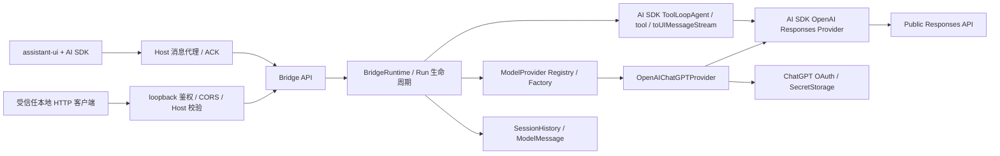

# Agent Bridge

仓库审查已接入六个只读工具，调用参数、快照语义与限制见 [仓库审查工具](review-tools.md)。

Bridge 运行在 VS Code Node.js Extension Host。首版实现 ChatGPT OAuth、Vercel AI SDK ToolLoopAgent、本地多轮会话、Function Tool、官方 AI SDK UI Message Stream 和受保护的 HTTP API。前端使用 `@assistant-ui/ai-sdk` 的 `useAISDKRuntime(useChat(...))`，适配已有会话列表；`AssistantChatTransport` 使用 Host 消息代理作为 Fetch 实现。OAuth 凭据与 loopback 服务访问凭据均不进入 webview，现有 `connect-src 'none'` CSP 保持生效。

## 安装与首次运行

要求 Bun ≥ 1.3.13、Node ≥ 22.12、VS Code ≥ 1.96，以及能访问 OpenAI 的本地 VS Code 窗口。

```sh
bun install --frozen-lockfile
bun run build
code .
```

Bridge 及其运行依赖在根工程的 `src/extension/` 与 `package.json` 中维护；前端位于独立的 `webview/` workspace，通过 `@shared/*` 使用 `src/shared/` 的协议和数据类型。一次根目录安装会准备两个工程。仅修改前端时可执行 `bun run --cwd webview build`；完整 `bun run test` 会依次运行根目录 Host / Shared / 构建测试和 `webview/tests/` 的 UI / Bridge 集成测试。

1. 按 F5 启动 Extension Development Host，信任打开的工作区，在 Source Control 展开 Meerkat。
2. 点击 **Continue with ChatGPT**，也可执行同名 Meerkat 命令。扩展先启动 `127.0.0.1` 临时端口上的 callback listener，再打开系统浏览器。
3. 在 OpenAI 页面完成登录、动态注册与 ChatGPT plan usage 授权。无需固定 Client ID、Platform API Key、client secret、Codex CLI 或 app-server。
4. 浏览器显示登录完成后回到面板。模型下拉框来自该账户的实时 `/v1/models` catalog，OAuth 响应保持官方顺序，只显示 `visibility: list` 的模型；解析器也兼容通用 API 的 `data[].id` 格式。
5. 退出并重启扩展后，OAuth 凭据从 VS Code SecretStorage 恢复；下一次模型列表/推理请求在令牌接近到期时刷新。登出会先停止运行、尝试撤销 refresh token，再清除本机令牌；远端撤销未确认时面板给出说明。

**Thinking：**模型目录返回的 `supported_reasoning_levels` / `default_reasoning_level` 或 `supportedReasoningEfforts` / `defaultReasoningEffort` 会统一为 Bridge 的 `supportedReasoningEfforts` 和 `defaultReasoningEffort`。仅展示上游提供且当前 SDK 支持的档位；缺少能力数据时返回空列表并隐藏 Thinking。默认档位会显示在选择器中，用户选择随会话保存。调整 Thinking 会保留同一会话的上下文，并通过每次 turn 的 `reasoningEffort` 传到 AI SDK OpenAI Provider 的 `providerOptions.openai.reasoningEffort`。生成期间禁用调整，Host 校验档位属于该会话模型的能力范围。

**账户与工作区准入：**官方文档描述的是 ChatGPT plan usage 预览。实际准入、订阅、workspace policy、模型、额度和工具权限以 OpenAI 的授权与接口返回为准。不能用一个有效 ID Token 推断推理权限；Bridge 检查 token response 中的 plan usage scopes。

授权响应省略 `scope` 时使用本次请求的 scopes；显式返回空值或缩减权限仍会被拒绝。拒绝授权或回调验证失败会结束等待、显示安全的失败原因并允许立即重试，已有 active account 保留。

选择历史会话时，模型选择框显示该会话绑定的模型；账户不匹配或模型不可用时给出提示。只有文字摘要、没有 Host 会话标识的旧历史需要新建会话；Host 重启后，有会话标识的历史从工作区会话归档恢复，已发生的工具调用、部分回答和每轮状态会回放到面板。中断的轮次标记为 `interrupted`，半截输出只用于展示、不进入模型上下文；用户可点“继续”，从最后一个检查点接着对话（用户请求在推理开始前已持久化，即使没有完成任何 step 也不会丢上下文）。归档缺失或检查点损坏时该会话只读，并给出可操作提示。面板保留全部历史，每次展示 20 条，可加载更多；超过最近 20 个会话时，通过 `POST /v1/sessions/:id/release` 释放较早会话的内存上下文，保留归档、已保存审查意见、解决状态、批注归档状态与代码快照。释放失败会持久化排队重试；旧版本因历史上限产生的待删除队列迁移为非破坏性的模型会话释放。释放后的历史可查看，继续模型对话时按需从归档恢复。只有显式删除会话才清理审查归档与会话归档。

## 从 HTTP API 验证真实推理

登录后执行 **Meerkat: Export Bridge Connection for API Testing**。提示给出 Host `globalStorageUri` 下的 `bridge-PID.json` 路径。文件以 `0600` 写入，仅包含本次进程的本地 Bridge 地址和访问凭据，关闭扩展时删除。该凭据可以在当前登录账户下调度推理；请仅交给受信任的本地客户端。它不包含 OAuth access/refresh/ID token。

```sh
bun run bridge:smoke /absolute/path/to/bridge-PID.json
```

脚本读取登录状态、获取当前账户模型、创建会话、发送消息、逐块输出 SSE，并核对 `x-vercel-ai-ui-message-stream: v1`、`text-delta`、`[DONE]` 和最终运行状态，最后删除会话。**这会使用你授权的 ChatGPT 额度。**

也可以使用 curl；`BRIDGE_FILE` 替换成命令返回的路径。这些变量只包含本地连接信息：

```sh
BRIDGE_FILE=/absolute/path/to/bridge-PID.json
BRIDGE_URL=$(jq -r '.baseUrl' "$BRIDGE_FILE")
BRIDGE_AUTH=$(jq -r '.authorization' "$BRIDGE_FILE")
curl -fsS "$BRIDGE_URL/v1/providers" -H "Authorization: $BRIDGE_AUTH"
curl -fsS "$BRIDGE_URL/v1/providers/openai-agents/auth" -H "Authorization: $BRIDGE_AUTH"
curl -fsS "$BRIDGE_URL/v1/providers/openai-agents/models" -H "Authorization: $BRIDGE_AUTH"
```

从返回结果选择实际可用模型，替换下面的 `MODEL_SLUG`：

```sh
BRIDGE_SESSION=$(curl -fsS "$BRIDGE_URL/v1/sessions" \
  -H "Authorization: $BRIDGE_AUTH" -H 'Content-Type: application/json' \
  -d '{"providerId":"openai-agents","model":"MODEL_SLUG"}' | jq -r '.id')
curl -N -D /tmp/meerkat-stream-headers "$BRIDGE_URL/v1/sessions/$BRIDGE_SESSION/messages" \
  -H "Authorization: $BRIDGE_AUTH" -H 'Content-Type: application/json' \
  -d '{"text":"Say exactly: Hello, world!"}'
```

请求响应头给出 `x-bridge-run-id`。运行状态与取消接口分别为 `GET /v1/runs/ID`、`POST /v1/runs/ID/cancel`。再次向同一会话发送**新增用户消息**即可继续对话。

## API

除了 OAuth 浏览器回调，所有 HTTP 接口都需要 `Authorization: Bearer <本次进程的随机访问凭据>`。JSON 请求使用 `Content-Type: application/json`。

| 方法         | 路径                                  | 输入 / 输出                                                                                                 |
| ------------ | ------------------------------------- | ----------------------------------------------------------------------------------------------------------- |
| GET          | `/v1/providers`                       | Provider 描述与能力                                                                                         |
| GET          | `/v1/providers/:id/auth`              | 登录状态、账户标识、授权 pending 与可选的安全 `signInError`；无令牌                                         |
| POST         | `/v1/providers/:id/login`             | `{}` 新注册，或 `{accountId}` 复用保存的注册；Host 打开浏览器                                               |
| GET          | `/auth/callback`                      | 官方 OAuth query；验证 state 后交换 code，仅返回固定文本                                                    |
| POST         | `/v1/providers/:id/logout`            | 清除本机凭据并返回 `remoteRevocationConfirmed`                                                              |
| GET          | `/v1/providers/:id/models`            | 实时、账户隔离的 `{id,name,supportedReasoningEfforts,defaultReasoningEffort?}[]`                            |
| POST         | `/v1/sessions`                        | `{providerId,model}` → `201` 会话元数据                                                                     |
| GET          | `/v1/sessions`                        | 合并当前 Host 会话与已归档会话，附 `live/archived/updatedAt/title/lastTurnStatus`                           |
| GET / DELETE | `/v1/sessions/:id`                    | 元数据（归档会话按需恢复）/ 取消关联运行并删除会话及其归档                                                  |
| POST         | `/v1/sessions/:id/release`            | 释放模型会话与内存上下文，保留审查意见、状态及引用快照                                                      |
| GET          | `/v1/sessions/:id/reviews`            | 当前会话审查运行记录及已保存意见，用于刷新恢复                                                              |
| GET          | `/v1/sessions/:id/transcript`         | 回放持久化的消息与工具部件，以及每轮 `status/checkpoints/error`；Webview 重载与 Host 重启后恢复使用         |
| POST         | `/v1/sessions/:id/reviews/:findingId` | `{status?,editorArchived?}` 更新解决或批注归档状态；至少一项，成功保存后通知界面                            |
| POST         | `/v1/sessions/:id/messages`           | `{text,reasoningEffort?,mode?:"chat"\|"review"}` → AI SDK UI Message SSE                                    |
| POST         | `/v1/chat`                            | `{sessionId,messages:UIMessage[],reasoningEffort?,mode?:"chat"\|"review"}` → SSE，仅取最后的 text 用户 turn |
| GET          | `/v1/runs/:id`                        | `running / completed / incomplete / cancelled / failed`                                                     |
| POST         | `/v1/runs/:id/cancel`                 | 将 AbortSignal 传至 SDK 与本地工具                                                                          |

普通错误使用 `{error:{code,message}}` 和对应 HTTP 状态码。流开始后的错误转换为 AI SDK 的 `error` chunk；`data-run-state` 是 transient data part，携带 session/run 标识与状态。SSE 封装和 `[DONE]` 来自 AI SDK，Agent 文本、工具输入和工具输出转换来自 AI SDK 官方 `toUIMessageStream`。

## 架构与扩展



| 模块                      | 职责                                                                                                   |
| ------------------------- | ------------------------------------------------------------------------------------------------------ |
| `auth`                    | OAuth、凭证存储、刷新和账户隔离                                                                        |
| `providers`               | `ModelProvider` 接口与注册表；提供 AI SDK `LanguageModel` 和厂商配置，OpenAI 适配使用 `@ai-sdk/openai` |
| `runtime/reviewAgent`     | 统一 `ToolLoopAgent` 配置、自然结束及可配置的 `stopWhen`、单次工具无响应超时、UI 流和成功历史提交      |
| `runtime/modeRouter`      | 复用当轮模型与用户选择的推理强度，自动判定本轮为聊天或审查；失败、无工具调用或低置信度降级为聊天       |
| `runtime/bridgeRuntime`   | run 状态、同会话互斥、取消、无响应计时、turn 日志/检查点落盘和关闭                                     |
| `sessions`                | Host 会话绑定及完整 `ModelMessage[]`，保留工具结果、namespace 和 encrypted reasoning metadata          |
| `sessions/sessionArchive` | 工作区文件归档：会话 metadata、逐步骤历史检查点、turn 状态与 UI 流日志、启动恢复与保留策略             |
| `sessions/transcript`     | 用 `readUIMessageStream` 回放 UI 流日志，恢复工具卡片、部分回答与每轮状态                              |
| `tools`                   | 通过 AI SDK `tool()` 定义厂商无关的本地工具                                                            |
| `transport`               | IPC Fetch 代理、响应头、ACK 背压与取消传播                                                             |
| `server`                  | 共用 Request/Response API 与受保护的 loopback HTTP 入口                                                |

用户不再选择交互模式，前端也不发送或保存该状态。每轮开始前，Host 通过 `runtime/modeRouter` 复用当轮模型与用户选择的推理强度调用一次意图路由：模型用单一工具返回 `chat` 或 `review`，`review` 才进入审查流程；路由失败、缺少工具调用、非法输出或低置信度一律按聊天处理，外部取消则透传而不是降级。旧客户端显式传入 `mode` 时直接采用该值并跳过路由。

普通聊天默认使用 `isLoopFinished()`，由 Agent 根据模型的结束状态自然收尾，不限制工具推理轮数。审查轮使用同一循环，逐条通过 `submit_review` 保存问题，经 `finish_review` 校验成功后直接停止，不再发起总结轮；收尾校验失败允许模型修正。系统根据真实状态和已保存意见生成完成提示，模型普通文本不展示为另一份审查报告。`ReviewAgentOptions.stopWhen` 仍支持业务停止条件；审查若被其提前停止且没有成功收尾，会明确失败。工具契约与覆盖范围校验见 [review-tools.md](review-tools.md#增量式审查)。

`ReviewAgentOptions.idleTimeoutMs` 默认 5 分钟，按无响应间隔计时，不限制整次审查时长。模型或工具有输出就重置整轮等待计时；每个并行工具另有独立计时，工具的中间结果会重置它自己的计时，其他工具的输出不会掩盖该工具卡住。超时会取消本轮并保留此前成功的会话历史。Host 代理与 Webview 使用比后端多 15 秒的传输空闲超时，并在收到响应时重置，避免旧的 2/2.5 分钟整轮限制提前中断长任务。

新增厂商时实现 `ModelProvider`，用对应的官方 AI SDK Provider 创建模型，并通过 `resolveModel()` 返回 `model`、`providerOptions` 和可选的工具厂商选项。在 `BridgeService` 注册适配器即可复用共享 Agent、工具、历史与消息流；厂商适配器不实现 Agent 循环、UI 流或专有 SDK Session。认证与模型目录仍由适配器管理。

前端 `useChat<ReviewChatMessage>` 消费同一 AI SDK 协议；工具消息类型通过 `InferUITools` 从后端定义推导，并声明系统审查状态/回执数据类型，`useAISDKRuntime` 将消息、发送和停止状态提供给 assistant-ui。`submitted/streaming` 表示运行中，正常结束及主动停止回到 `ready`，错误进入 `error`。切换会话会停止旧请求，面板销毁取消 IPC 操作，扩展退出关闭 Bridge。审查意见写入独立 Host 账本后即时缓存到 webview；刷新及终态重新读取 `/reviews` 恢复已保存 Tool UI，Host 尚在取消时短暂查询直到终态。正常流式交互仍由 SSE 驱动。

保留已有 `openai-agents` Provider ID 以兼容面板、登录命令、HTTP 客户端和 smoke 脚本；该标识不表示仍使用 OpenAI Agents SDK。OAuth 的存储键和注册信息不变。Host 执行期的 provider 会话仍在内存，但每轮的用户消息、用户实际看到的 UI 流和每个模型步骤后的完整 `ModelMessage[]` 检查点都会写入会话归档；Host 重启后从归档恢复，被中断的轮次需要用户确认后继续。

## OAuth 与本地安全

每个 host 的 UUIDv4 `ext_agent_host_id` 在首次授权前存入 SecretStorage。首次用 `dynamic_agent_client`、`agent_name_hint=Meerkat`、S256 PKCE 和必要 scopes 发起授权；code exchange 使用 callback 返回的 `oaiapp_...` issued Client ID。复用账户时保持 host/client 映射，只加入对应账户的登录提示。验证 state 的一次性消费、nonce、RS256 签名、issuer、audience、subject 与到期时间后才替换 active account。Refresh 返回 ID Token 时也验证签名和身份。

SecretStorage 保存 host ID、独立注册映射、validated subject/email、issued Client ID、scopes、token expiry、ID/access/refresh tokens。Refresh 在到期前一分钟触发并尊重 `earliest_refresh_at`；同一 Host 用队列与 owner-only 文件锁串行化跨窗口更新，并在锁内重新加载 vault。失效 grant 或 401 清除相应凭据，网络故障保留凭据以便重试。登出保留 host/client/identity 映射，删除所选账户的全部令牌。该实现不将令牌加入普通日志，不启用 SDK telemetry；错误仅返回经过脱敏的 BridgeError。

HTTP 仅绑定 `127.0.0.1`，校验 exact Host、随机访问凭据和 Origin 白名单，拒绝 1 MiB 以上请求。CORS 默认不允许浏览器 Origin；其他受信任 UI 集成可以在 `BridgeHttpServer` 的 `allowedOrigins` 明确指定 origin，仍需本地访问凭据。webview 不直接连接 HTTP，使用有上限的 IPC 请求、响应头白名单、ACK 背压与视图销毁取消。未信任工作区及 Remote 窗口拒绝启动。SDK/网络错误只输出固定、可公开的信息，不透传 SDK error body。

锁文件仅保存 PID，不含令牌。持有者已退出的锁可以回收。若进程恰好在写入 PID 或极短的 recovery critical section 内崩溃，锁会保守地拒绝访问；确认相关 VS Code 窗口全部关闭后，可以删除 globalStorage 下的 `oauth.lock` 与 `oauth.lock.reclaim`。不要删除运行中进程的锁。

## 最新官方兼容约束与验证边界

按 **2026-10-15** 获取的官方文档，以及安装的 `ai@7.0.141`、`@ai-sdk/openai@4.0.94` 实现：

- OAuth 推理只访问 `https://api.openai.com/v1/responses`，每次 HTTP 请求强制验证 `store:false`、`stream:true`、array input；使用账户独立的 `createOpenAI()` 实例和官方 Responses Provider。
- 本地 Session 发送完整历史，不使用 `conversation`、`previous_response_id` 。加上 `reasoning.encrypted_content` 以支持 stateless reasoning 历史。成功终止并消费完整 stream 后才提交本轮；失败、中断或取消会丢弃 未提交历史。
- 真实账户验收发现部分 ChatGPT plan usage 响应的 `response.completed.output` 为空，而 `response.output_item.done` 已给出完整回答，且 Extension Host 收到的 HTTP 响应可能缺少 `Content-Type`。兼容层依据已校验的 `stream:true` 请求解析 SSE，不依赖响应头；按 `output_index` 恢复结束事件的输出，供官方 Provider 正确结束运行，避免一次发送被反复推理。依据 `response.completed` 事件判断完成，不依赖结束载荷重复提供 `status: completed`；失败状态或错误载荷不修复。已有完整结束输出时保持其为准；缺少已完成条目时直接失败，不自动重复生成。
- 兼容层检查 SDK **实际序列化的请求**，拒绝官方当前不支持的字段。测试覆盖真实 AI SDK 与 OpenAI Provider 生成的多轮消息、工具循环、namespace、取消、失败/不完整/截断流、推理强度和 UI 转换器。
- 首版工具仅启用 namespaced 本地 Function Tool。Hosted MCP、tool search、image generation、file search、Code Interpreter、native computer use、平台 Files API 和 audio/video 输入没有启用；请求校验拒绝非 text 用户输入。工具执行不会读写工作区文件，也不运行 shell。
- API 不接受任意 Agent instructions 或前端工具执行/approval-resume。`/v1/chat` 不重复追加客户端 transcript；新增用户 turn 由 Host session 管理。多个账户的注册可保存，但首版只有一个 active account，不是面向远程多用户的服务。
- OAuth 登录持久化。Host 执行期会话在内存：每会话模型历史最多 2 MiB、最多 100 个内存会话，运行状态保留约 200 条；超过 2 MiB 时先移除工具调用/结果并保留用户与 assistant 文本，不再让成功回合直接失败。与此同时，会话 metadata（含模型 reasoning 能力）、逐步骤 `ModelMessage[]` 检查点和 UI 流日志写入工作区扩展存储的 `sessions-v1/`（默认保留 50 个会话、每会话 200 轮、总量 256 MiB；单轮 UI 日志上限 8 MiB，超出部分标记截断）。Host 重启时把遗留的 `running` 轮次标为 `interrupted`；`GET /v1/sessions/:id/transcript` 回放用户实际看到的文本与工具调用，继续对话时使用最后一个完整步骤的检查点，半截回答不进入模型上下文。归档写入失败只降低可恢复性，不阻断推理；检查点损坏的会话只读。webview 仍保存最近 20 个会话的文字摘要（每条最多 4000 字符）作为回退，工具 UI 的完整形态来自归档。P0 不实现同一 Host 进程内的直播流重连，该场景由 P2 的 run 生命周期解耦与流缓冲处理。
- 自动化集成测试使用真实 React、assistant-ui、AI SDK Agent、IPC、API 与 SessionStore；远端模型/OAuth 由显式 fixtures 代替。覆盖流式渲染、工具 UI、停止、历史保护、账户/模型绑定和超过 100 次会话清理。
- 真实 ChatGPT 账户的登录、额度、refresh/revoke 及各 OS 凭据后端仍需账户验收；上面的 smoke 脚本提供真实调用路径，自动化 fixtures 不冒充真实账户推理。

```sh
bun run check
bun run build
bun run package
```

官方资料：[AI SDK Agent](https://ai-sdk.dev/docs/agents/building-agents)、[OpenAI Provider](https://ai-sdk.dev/providers/ai-sdk-providers/openai)、[assistant-ui AI SDK v7](https://www.assistant-ui.com/docs/runtimes/ai-sdk/v7)、[动态注册与登录](https://developers.openai.com/siwc/token-sharing-open-source/sign-in)、[账户与刷新](https://developers.openai.com/siwc/token-sharing-open-source/profiles-and-sessions)、[模型与推理](https://developers.openai.com/siwc/token-sharing-open-source/models-and-inference)、[预览限制](https://developers.openai.com/siwc/token-sharing-open-source/preview-limitations)。
