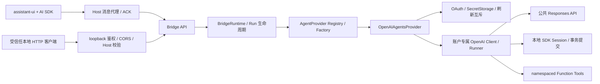

# Agent Bridge

Bridge 运行在 VS Code Node.js Extension Host。首版实现 ChatGPT OAuth、OpenAI Agents SDK、本地多轮会话、Function Tool、官方 AI SDK UI Message Stream 和受保护的 HTTP API。前端使用 `@assistant-ui/ai-sdk` 的 `useAISDKRuntime(useChat(...))`，适配已有会话列表；`AssistantChatTransport` 使用 Host 消息代理作为 Fetch 实现。OAuth 凭据与 loopback 服务访问凭据均不进入 webview，现有 `connect-src 'none'` CSP 保持生效。

## 安装与首次运行

要求 Bun ≥ 1.3.13、Node ≥ 22.12、VS Code ≥ 1.96，以及能访问 OpenAI 的本地 VS Code 窗口。

```sh
bun install --frozen-lockfile
bun run build
code .
```

Bridge 及其运行依赖在根工程的 `src/extension/` 与 `package.json` 中维护；前端位于独立的 `webview/` workspace，通过 `@shared/*` 使用 `src/shared/` 的协议和数据类型。一次根目录安装会准备两个工程。仅修改前端时可执行 `bun run --cwd webview build`；完整 `bun run test` 会依次运行根目录 Host / Shared / 构建测试和 `webview/tests/` 的 UI / Bridge 集成测试。

1. 按 F5 启动 Extension Development Host，信任打开的工作区，在 Source Control 展开 Review Bot。
2. 点击 **Continue with ChatGPT**，也可执行同名 Review Bot 命令。扩展先启动 `127.0.0.1` 临时端口上的 callback listener，再打开系统浏览器。
3. 在 OpenAI 页面完成登录、动态注册与 ChatGPT plan usage 授权。无需固定 Client ID、Platform API Key、client secret、Codex CLI 或 app-server。
4. 浏览器显示登录完成后回到面板。模型下拉框来自该账户的实时 `/v1/models` catalog，OAuth 响应保持官方顺序，只显示 `visibility: list` 的模型；解析器也兼容通用 API 的 `data[].id` 格式。
5. 发送文字或粘贴代码，观察文字逐步生成。可发送“用 inspect_text 检查这段代码的 TODO 标记”测试 Function Tool。点击 **停止**取消。切换模型会开始新会话。
6. 退出并重启扩展后，OAuth 凭据从 VS Code SecretStorage 恢复；下一次模型列表/推理请求在令牌接近到期时刷新。登出会先停止运行、尝试撤销 refresh token，再清除本机令牌；远端撤销未确认时面板给出说明。

**Thinking：**模型目录返回的 `supported_reasoning_levels` / `default_reasoning_level` 或 `supportedReasoningEfforts` / `defaultReasoningEffort` 会统一为 Bridge 的 `supportedReasoningEfforts` 和 `defaultReasoningEffort`。仅展示上游提供且当前 SDK 支持的档位；缺少能力数据时返回空列表并隐藏 Thinking。默认档位会显示在选择器中，用户选择随会话保存。调整 Thinking 会保留同一会话的上下文，并通过每次 turn 的 `reasoningEffort` 传到 Agents SDK 的 `modelSettings.reasoning.effort`。生成期间禁用调整，Host 校验档位属于该会话模型的能力范围。

**账户与工作区准入：**官方文档描述的是 ChatGPT plan usage 预览。实际准入、订阅、workspace policy、模型、额度和工具权限以 OpenAI 的授权与接口返回为准。不能用一个有效 ID Token 推断推理权限；Bridge 检查 token response 中的 plan usage scopes。

授权响应省略 `scope` 时使用本次请求的 scopes；显式返回空值或缩减权限仍会被拒绝。拒绝授权或回调验证失败会结束等待、显示安全的失败原因并允许立即重试，已有 active account 保留。

选择历史会话时，模型选择框显示该会话绑定的模型；账户不匹配或模型不可用时给出提示。只有文字摘要、没有 Host 会话标识的旧历史，以及 Host 重启后失效的历史，需要新建会话。超过最近 20 个会话的限制时，面板会删除被移除的 Host 会话；失败的删除保存在 webview state 中，自动重试并在重新打开面板后继续处理。

## 从 HTTP API 验证真实推理

登录后执行 **Review Bot: Export Bridge Connection for API Testing**。提示给出 Host `globalStorageUri` 下的 `bridge-PID.json` 路径。文件以 `0600` 写入，仅包含本次进程的本地 Bridge 地址和访问凭据，关闭扩展时删除。该凭据可以在当前登录账户下调度推理；请仅交给受信任的本地客户端。它不包含 OAuth access/refresh/ID token。

```sh
bun run bridge:smoke /absolute/path/to/bridge-PID.json
```

脚本读取登录状态、获取当前账户模型、创建会话、发送消息、逐块输出 SSE，并核对 `x-vercel-ai-ui-message-stream: v1`、`text-delta`、`[DONE]` 和最终运行状态，最后删除会话。**这会使用你授权的 ChatGPT 额度。**

也可以使用 curl；`BRIDGE_FILE` 替换成命令返回的路径。这些变量只包含本地连接信息：

```sh
BRIDGE_FILE=/absolute/path/to/bridge-PID.json
BRIDGE_URL=$(jq -r '.baseUrl' "$BRIDGE_FILE")
BRIDGE_AUTH=$(jq -r '.authorization' "$BRIDGE_FILE")
curl -fsS "$BRIDGE_URL/v1/providers" -H "Authorization: $BRIDGE_AUTH"
curl -fsS "$BRIDGE_URL/v1/providers/openai-agents/auth" -H "Authorization: $BRIDGE_AUTH"
curl -fsS "$BRIDGE_URL/v1/providers/openai-agents/models" -H "Authorization: $BRIDGE_AUTH"
```

从返回结果选择实际可用模型，替换下面的 `MODEL_SLUG`：

```sh
BRIDGE_SESSION=$(curl -fsS "$BRIDGE_URL/v1/sessions" \
  -H "Authorization: $BRIDGE_AUTH" -H 'Content-Type: application/json' \
  -d '{"providerId":"openai-agents","model":"MODEL_SLUG"}' | jq -r '.id')
curl -N -D /tmp/review-bot-stream-headers "$BRIDGE_URL/v1/sessions/$BRIDGE_SESSION/messages" \
  -H "Authorization: $BRIDGE_AUTH" -H 'Content-Type: application/json' \
  -d '{"text":"Say exactly: Hello, world!"}'
```

请求响应头给出 `x-bridge-run-id`。运行状态与取消接口分别为 `GET /v1/runs/ID`、`POST /v1/runs/ID/cancel`。再次向同一会话发送**新增用户消息**即可继续对话。

## API

除了 OAuth 浏览器回调，所有 HTTP 接口都需要 `Authorization: Bearer <本次进程的随机访问凭据>`。JSON 请求使用 `Content-Type: application/json`。

| 方法         | 路径                        | 输入 / 输出                                                                          |
| ------------ | --------------------------- | ------------------------------------------------------------------------------------ |
| GET          | `/v1/providers`             | Provider 描述与能力                                                                  |
| GET          | `/v1/providers/:id/auth`    | 登录状态、账户标识、授权 pending 与可选的安全 `signInError`；无令牌                  |
| POST         | `/v1/providers/:id/login`   | `{}` 新注册，或 `{accountId}` 复用保存的注册；Host 打开浏览器                        |
| GET          | `/auth/callback`            | 官方 OAuth query；验证 state 后交换 code，仅返回固定文本                             |
| POST         | `/v1/providers/:id/logout`  | 清除本机凭据并返回 `remoteRevocationConfirmed`                                       |
| GET          | `/v1/providers/:id/models`  | 实时、账户隔离的 `{id,name,supportedReasoningEfforts,defaultReasoningEffort?}[]`     |
| POST         | `/v1/sessions`              | `{providerId,model}` → `201` 会话元数据                                              |
| GET          | `/v1/sessions`              | 当前 Host 会话列表                                                                   |
| GET / DELETE | `/v1/sessions/:id`          | 元数据 / 取消关联运行并删除会话                                                      |
| POST         | `/v1/sessions/:id/messages` | `{text,reasoningEffort?}` → AI SDK UI Message SSE                                    |
| POST         | `/v1/chat`                  | `{sessionId,messages:UIMessage[],reasoningEffort?}` → SSE，仅取最后的 text 用户 turn |
| GET          | `/v1/runs/:id`              | `running / completed / cancelled / failed`                                           |
| POST         | `/v1/runs/:id/cancel`       | 将 AbortSignal 传至 SDK 与本地工具                                                   |

普通错误使用 `{error:{code,message}}` 和对应 HTTP 状态码。流开始后的错误转换为 AI SDK 的 `error` chunk；`data-run-state` 是 transient data part，携带 session/run 标识与状态。SSE 封装和 `[DONE]` 来自 AI SDK，Agent 文本、工具输入和工具输出转换来自 OpenAI 官方 `createAiSdkUiMessageStream`。

## 架构与扩展



`src/extension/bridge/` 按责任划分：

| 模块         | 责任                                                                         |
| ------------ | ---------------------------------------------------------------------------- |
| `auth`       | discovery、PKCE、OIDC/JWKS 验证、凭据 vault、refresh/revoke、跨进程锁        |
| `providers`  | 统一 AgentProvider 接口、Registry/Factory；OpenAI 兼容约束留在其 Provider 内 |
| `runtime`    | 同会话排他执行、run 状态、超时、AbortSignal、登出及关闭清理                  |
| `transport`  | webview 安全消息代理、逐块 ACK 背压、UTF-8 边界                              |
| `sessions`   | 有上限的本地会话、官方 SDK Session 接口、失败/取消回滚                       |
| `tools`      | 真实 `inspect_text` Function Tool，仅处理用户提供的文字                      |
| `server`     | Fetch 风格路由、Node HTTP、loopback 访问控制、输入校验与统一错误             |
| `service.ts` | VS Code 生命周期、SecretStorage、system browser、惰性启动                    |

添加 Provider 时实现 `AgentProvider`，通过 `registry.register(() => new YourProvider(...))` 注册。初始化、认证、模型目录、内部会话、执行、取消信号和关闭都经统一接口；Provider 可以使用不同 SDK，并在自身实现中验证专属参数。核心路由与调度器不引用 OpenAI SDK。`ProviderSession.state` 保持 opaque，可替换为其他 SDK 会话；账户 ID 和模型固定在创建的会话上。未来持久化会话可实现同一 SDK Session 接口，并替换 SessionStore。

## OAuth 与本地安全

每个 host 的 UUIDv4 `ext_agent_host_id` 在首次授权前存入 SecretStorage。首次用 `dynamic_agent_client`、`agent_name_hint=Review Bot`、S256 PKCE 和必要 scopes 发起授权；code exchange 使用 callback 返回的 `oaiapp_...` issued Client ID。复用账户时保持 host/client 映射，只加入对应账户的登录提示。验证 state 的一次性消费、nonce、RS256 签名、issuer、audience、subject 与到期时间后才替换 active account。Refresh 返回 ID Token 时也验证签名和身份。

SecretStorage 保存 host ID、独立注册映射、validated subject/email、issued Client ID、scopes、token expiry、ID/access/refresh tokens。Refresh 在到期前一分钟触发并尊重 `earliest_refresh_at`；同一 Host 用队列与 owner-only 文件锁串行化跨窗口更新，并在锁内重新加载 vault。失效 grant 或 401 清除相应凭据，网络故障保留凭据以便重试。登出保留 host/client/identity 映射，删除所选账户的全部令牌。该实现不将令牌加入普通日志，关闭 OpenAI Client 日志、SDK 敏感数据日志与 Runner tracing。

HTTP 仅绑定 `127.0.0.1`，校验 exact Host、随机访问凭据和 Origin 白名单，拒绝 1 MiB 以上请求。CORS 默认不允许浏览器 Origin；其他受信任 UI 集成可以在 `BridgeHttpServer` 的 `allowedOrigins` 明确指定 origin，仍需本地访问凭据。webview 不直接连接 HTTP，使用有上限的 IPC 请求、响应头白名单、ACK 背压与视图销毁取消。未信任工作区及 Remote 窗口拒绝启动。SDK/网络错误只输出固定、可公开的信息，不透传 SDK error body。

锁文件仅保存 PID，不含令牌。持有者已退出的锁可以回收。若进程恰好在写入 PID 或极短的 recovery critical section 内崩溃，锁会保守地拒绝访问；确认相关 VS Code 窗口全部关闭后，可以删除 globalStorage 下的 `oauth.lock` 与 `oauth.lock.reclaim`。不要删除运行中进程的锁。

## 最新官方兼容约束与验证边界

按 **2026-10-14** 获取的官方文档以及安装的 Agents SDK **0.20.0** 实现：

- OAuth 推理只访问 `https://api.openai.com/v1/responses`，每次 HTTP 请求强制验证 `store:false`、`stream:true`、array input；使用账户独立的 OpenAI Client 注入 OpenAIProvider/Runner。
- 本地 Session 发送完整历史，不使用 `conversation`、`previous_response_id` 或 OpenAIConversationsSession。加上 `reasoning.encrypted_content` 以支持 stateless reasoning 历史。成功终止并消费完整 stream 后才提交本轮；失败、中断或取消会丢弃 staged history。
- 真实账户验收发现部分 ChatGPT plan usage 响应的 `response.completed.output` 为空，而 `response.output_item.done` 已给出完整回答，且 Extension Host 收到的 HTTP 响应可能缺少 `Content-Type`。兼容层依据已校验的 `stream:true` 请求解析 SSE，不依赖响应头；按 `output_index` 恢复结束事件的输出，供官方 SDK 正确结束运行并保存历史，避免一次发送被反复推理。与 SDK 一样依据 `response.completed` 事件判断完成，不依赖结束载荷重复提供 `status: completed`；失败状态或错误载荷不修复。已有完整结束输出时保持其为准；缺少已完成条目时直接失败，不自动重复生成。
- 兼容层检查 SDK **实际序列化的请求**，拒绝官方当前不支持的字段。测试覆盖 SDK 真实生成的两轮消息、两次模型调用的 Function Tool、namespace、取消、失败/不完整/截断流和官方 UI 转换器。
- 首版工具仅启用 namespaced 本地 Function Tool。Hosted MCP、tool search、image generation、file search、Code Interpreter、native computer use、平台 Files API 和 audio/video 输入没有启用；请求校验拒绝非 text 用户输入。工具执行不会读写工作区文件，也不运行 shell。
- API 不接受任意 Agent instructions 或前端工具执行/approval-resume。`/v1/chat` 不重复追加客户端 transcript；新增用户 turn 由 Host session 管理。多个账户的注册可保存，但首版只有一个 active account，不是面向远程多用户的服务。
- OAuth 登录持久化；Host Agent 会话暂存内存，每会话最多 2 MiB、最多 100 个会话，运行状态保留约 200 条。Host 重启后必须新建 Agent 会话。webview 继续保存最近 20 个会话的文字摘要，每条最多 4000 字符；工具 UI 在当前运行中可见，历史摘要不包含完整工具部件。没有宣称实现断线恢复或持久化 Agent 历史。
- **已由用户手动验收：**本轮审查修复前的真实登录与发送消息获得响应。新增回归测试挂载真实 React 界面，经过 IPC 代理、Bridge API 和 SessionStore，覆盖授权失败重试、旧历史保护、模型/账户绑定、连续创建 105 个会话及失败删除的恢复。
- **尚未验证：**真实账户的 refresh/revoke、完整模型目录与额度边界；最低支持版本及各 OS 凭据后端。新增边界场景的自动测试使用显式 HTTP/OAuth fixtures、签名 JWT 和替代远端 Provider；真实 SDK/协议转换器由独立测试覆盖。上面的 smoke 脚本提供真实账户验收路径。

```sh
bun run check
bun run build
bun run package
```

官方资料：[assistant-ui OpenAI Agents 集成](https://www.assistant-ui.com/docs/integrations/frameworks/openai-agents)、[AI SDK v7](https://www.assistant-ui.com/docs/runtimes/ai-sdk/v7)、[Agents AI SDK UI](https://openai.github.io/openai-agents-js/extensions/ai-sdk/)、[动态注册与登录](https://developers.openai.com/siwc/token-sharing-open-source/sign-in)、[账户与刷新](https://developers.openai.com/siwc/token-sharing-open-source/profiles-and-sessions)、[Token reference](https://developers.openai.com/siwc/token-sharing-open-source/token-reference)、[模型与推理](https://developers.openai.com/siwc/token-sharing-open-source/models-and-inference)、[预览限制](https://developers.openai.com/siwc/token-sharing-open-source/preview-limitations)。
