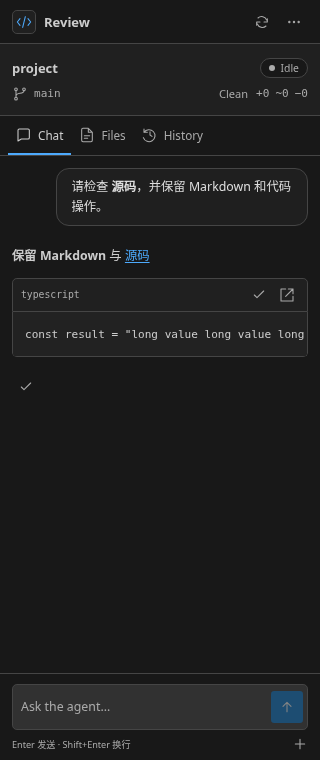
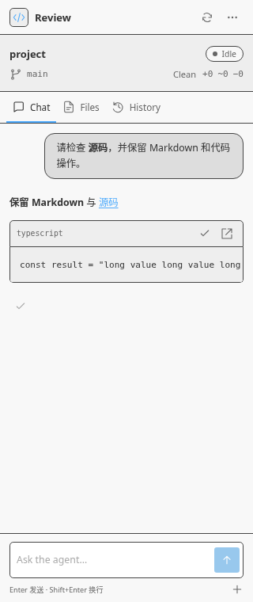

# Message-pair runtime previews

These previews show the production Webview bundle in Chromium at a 320 × 760 viewport. The VS Code Host bridge, chat messages, and theme variables are supplied by a local validation fixture; these are not screenshots of an actual Extension Development Host session.

The layout follows the official assistant-ui message-pair Runtime recipe: a right-aligned user bubble, an assistant reply without a bubble, and copy actions revealed on hover or keyboard focus. Existing Markdown, code actions, file references, and session storage are retained. Full-response copy uses the Extension Host bridge. No model, regeneration, or simulated streaming is added.

## Dark theme

## Light theme

Validated interactions include keyboard response copy, code copy/open, file references, sending messages, creating and restoring sessions, HTML safety, and overflow at 260, 320, and 480 pixels. The user bubble's high-contrast border was also checked in Chromium.
