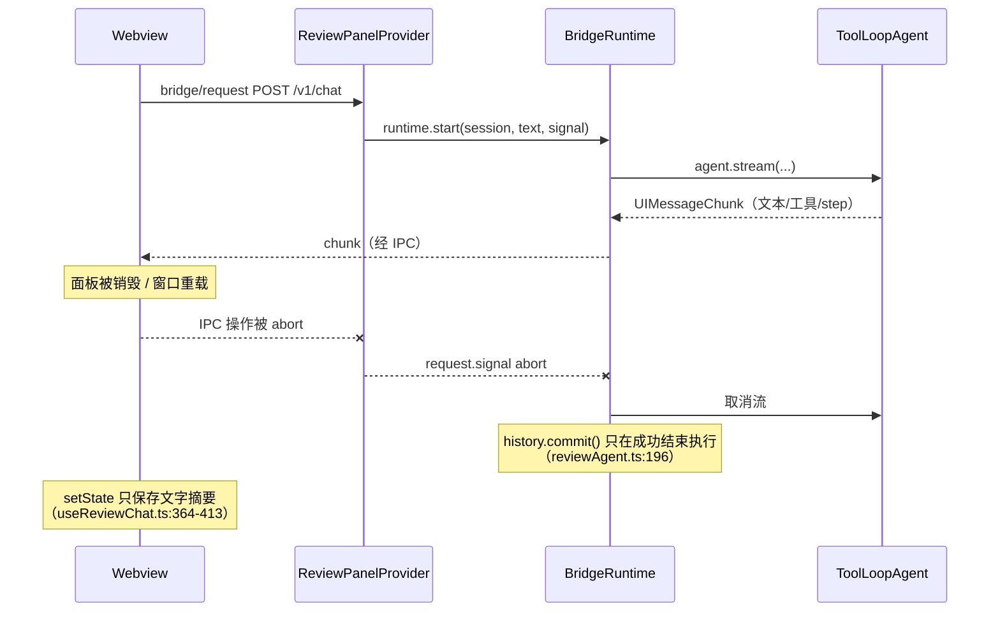

# 会话状态持久化与中断恢复

本文是「会话状态管理」的设计与实现记录，目标是解决：回答进行到一半时关闭面板 / 重载窗口 / 退出 VS Code，回答被中断，重新打开后既不能继续上下文，也看不到已经发生的工具调用与部分输出。

**实现状态：P0 已落地。** 下列「推荐方案」中的 Host 归档、逐步骤检查点、turn 流日志、启动恢复、transcript 回放、Webview 水合、中断提示与「继续」均已实现并有测试覆盖；P1/P2 仍按文末计划推进。实现细节与设计的主要差异：

- 聊天流的 `start` chunk 不携带 messageId，transcript 回放用 `assistant-<runId>` 生成稳定 id，避免与用户轮次 id 冲突。
- 归档目录直接位于 `context.storageUri ?? globalStorageUri` 下的 `sessions-v1/`。
- 单轮日志上限 8 MiB、保留 50 会话 / 200 轮 / 256 MiB 已作为常量实现；超限轮次标记 `transcriptTruncated`，会话级裁剪在 `SessionArchive.recover()` 中完成。
- Webview 水合后仍用现有 `restoreReviewMessages` 合并审查卡片；评审状态仍以 `ReviewArchive` 为唯一真源。
- 半截回答只展示、不进入模型上下文；「继续」发送普通用户 turn（`继续` / `继续审查剩下的文件`），不自动重跑工具。
- 用户轮次在推理开始前写入 `steps=0` 检查点；即使中断发生在第一个 step 完成前，该请求也会进入模型上下文，继续时不会变成无上下文的新问题。
- 会话 metadata 同时保存模型能力（`supportedReasoningEfforts` / `defaultReasoningEffort`），重启后继续对话不会因丢失能力列表而拒绝 reasoning effort；更早的归档没有能力数据时，provider 接受显式传入的 effort（有目录数据的会话仍严格校验）。
- 归档写失败只记日志，不阻断推理；损坏的 `history.json` 使会话只读，损坏的 turn 记录被跳过并标记 transcript 截断。

### 实现与测试入口

| 能力                               | 实现                                                                                                       | 测试                                                                             |
| ---------------------------------- | ---------------------------------------------------------------------------------------------------------- | -------------------------------------------------------------------------------- |
| 归档、恢复、保留、删除             | `src/extension/bridge/sessions/sessionArchive.ts`                                                          | `tests/sessionArchive.test.ts`                                                   |
| UI 流回放                          | `src/extension/bridge/sessions/transcript.ts`                                                              | 同上 + `tests/sessionPersistence.test.ts`                                        |
| 检查点注入                         | `src/extension/bridge/runtime/reviewAgent.ts`（`onStepEnd`）                                               | `tests/sessionPersistence.test.ts`                                               |
| turn 日志、终端状态、惰性恢复、API | `src/extension/bridge/runtime/bridgeRuntime.ts`、`server/api.ts`、`service.ts`                             | `tests/sessionPersistence.test.ts`                                               |
| Webview 水合/提示/继续             | `webview/src/hooks/useReviewChat.ts`、`state/sessionTranscript.ts`、`components/SessionRecoveryNotice.tsx` | `webview/tests/sessionTranscript.test.ts`、`webview/tests/webviewBridge.test.ts` |

当前实现见 [Agent Bridge](agent-bridge.md)。该文档末尾「没有宣称实现断线恢复或持久化 Agent 历史」的边界会在本方案落地后更新。

## 现状与根因

### 状态盘点

| 状态                                                             | 位置                                                              | 生命周期                     | 中断后                      |
| ---------------------------------------------------------------- | ----------------------------------------------------------------- | ---------------------------- | --------------------------- |
| Host 会话绑定（provider/model/account）                          | `SessionStore` 内存 Map（`sessions/store.ts`）                    | 当前 Extension Host 进程     | 丢失，接口 404              |
| 完整模型历史 `ModelMessage[]`（含工具结果、encrypted reasoning） | `SessionHistory` 内存（`sessions/history.ts`）                    | 当前进程                     | 丢失                        |
| run 状态与取消                                                   | `BridgeRuntime.runs` 内存（`runtime/bridgeRuntime.ts`）           | 当前进程                     | 丢失                        |
| 审查意见、运行状态、解决/归档状态                                | `ReviewArchive` + `workspaceState`（`sessions/reviewArchive.ts`） | 持久（workspace 级 Memento） | 保留，running 转 incomplete |
| 代码引用快照                                                     | `FileReferenceArchive` 文件（`sessions/fileReferenceArchive.ts`） | 持久                         | 保留                        |
| 前端会话列表、标题、草稿、文字摘要                               | Webview `setState`（`webview/src/state/reviewState.ts`）          | 持久（视图状态）             | 保留（只有文字）            |
| 前端完整消息（含工具部件）、流式增量                             | `useChat` 内存（`webview/src/hooks/useReviewChat.ts`）            | 当前 Webview                 | 丢失                        |

### 中断链路



根因有三点：

1. **上下文只提交在成功终点**。`streamReviewAgent` 只有在 `next.done` 且校验通过后才 `session.history.commit()`；任何取消、超时、进程退出都会让本轮已完成的所有工具调用与模型步骤一起作废。
2. **没有可用于展示的持久流**。工具调用与部分输出只存在于 `useChat` 的实时状态里，`saveMessages` 只把最后合并的纯文本写进 Webview 状态（每条截断 4000 字符），刷新后 `restoreReviewMessages` 只能从审查回执重建 `submit_review` 卡片，普通聊天的工具卡片完全消失。
3. **Host 会话被当作纯临时对象**。`SessionStore` 启动时是空 Map，`GET /v1/sessions/:id` 直接 404，前端只能提示「Host 会话已结束，请新建会话」（`useReviewChat.ts:202-205`），历史对话被强行降级成新的无上下文会话。

结论：需要一套 **Host 侧、文件级、可增量写入** 的会话归档；前端状态保持轻量，只作为缓存与回退。

## 目标与非目标

**目标**

- 关闭面板、重载 Webview、退出并重开 VS Code 后：会话列表仍在，能进入原会话，完整看到已发生的工具调用、工具结果与部分回答。
- 能从最后一个「已完成 step」的检查点继续对话；不把半截回答塞进模型上下文造成歧义。
- 审查会话中断后：已保存意见、解决状态、引用快照不变；审查运行明确标为未完成，可继续审查。
- 持久化失败不阻断推理与审查回执的现有语义；最坏情况下退化到当前行为。

**非目标**

- 不承诺恢复「正在进行的模型调用 / 正在执行的工具」本身。模型 API 与工具执行不可断点续传，能保留的是已完成步骤与可见输出。
- 不做跨机器同步、云端账户、团队共享。
- 不改变 Host 拥有完整上下文、前端不向模型发送 transcript 的边界。
- 不引入数据库（文件归档已足够，且与 `FileReferenceArchive` 的成熟模式一致）。

## 方案对比

| 方案                                                    | 上下文可恢复 | 工具/部分输出可回放                              | 跨 Host 重启 | 复杂度/风险                            |
| ------------------------------------------------------- | ------------ | ------------------------------------------------ | ------------ | -------------------------------------- |
| A. 仅前端持久化（Webview state / Memento）              | 否           | 受容量与协议限制                                 | 是           | 低，但解决不了「没有上下文」的核心问题 |
| B. 仅持久化 `ModelMessage[]`                            | 是           | 需自定义 Message→UI 转换，半截文本与工具时序丢失 | 是           | 中，展示保真度差                       |
| C. Host 归档：`ModelMessage` 检查点 + UI 流日志（推荐） | 是           | 是（原生 `readUIMessageStream`）                 | 是           | 中高，一次把扩展点做对即可             |
| D. assistant-ui 远程线程列表 / Assistant Cloud          | 是           | 是                                               | 依赖外部服务 | 高，超出本地离线扩展定位               |
| E. SQLite / 外部 KV                                     | 是           | 是                                               | 是           | 中高，原生依赖与打包成本不划算         |

选 C：把「模型上下文」和「界面展示」拆成两条持久化数据线，用 Host 已有的工具（`onStepEnd`、`readUIMessageStream`、原子文件写）实现，前端只在打开会话时回灌。

## 推荐方案：Host 会话归档（Session Archive）

### 核心原则

1. **上下文以 Host 的检查点为准**：`history.json` 只保存「可安全用于下一次推理的完整前缀」，即用户消息 + 所有已完成 step 的 assistant / tool 消息。半个 step 的部分文本不进入上下文。
2. **展示以 turn 日志为准**：每个 run 的 `UIMessageChunk` 追加写入文件，重开时用 `readUIMessageStream` 还原成 `UIMessage[]`。工具调用参数、工具结果、半截文本都按用户实际看到的样子恢复。
3. **两者分离、各自可降级**：日志损坏时回退到文字摘要；检查点损坏时该会话只读。
4. **归档是外挂依赖**：`BridgeRuntime` / `SessionStore` 以可选依赖注入归档；未注入时行为与今天完全一致（现有测试夹具零改动）。
5. **中断必须显式**：Host 重启时把所有 `running` 的 turn 标成 `interrupted`，绝不静默当作完成。

### 目录布局

归档放在 workspace 级扩展存储下（与代码引用一致，`context.storageUri ?? context.globalStorageUri`）：

```
<storageUri>/sessions-v1/
  <sessionId>/
    meta.json                 # providerId/model/accountId/createdAt/updatedAt/title/version
    history.json              # { version, sessionId, messages: ModelMessage[], checkpoint: { runId, steps, at } }
    turns/
      <runId>.json            # turn 元数据与状态（原子重写）
      <runId>.jsonl           # UIMessageChunk 追加日志（跳过 transient data part）
```

`<runId>.json`：

```json
{
  "version": 1,
  "runId": "…",
  "sessionId": "…",
  "text": "用户这一轮输入",
  "mode": "chat",
  "status": "running",
  "checkpoints": 3,
  "reviewRunId": "…",
  "startedAt": "…",
  "endedAt": "…",
  "error": { "code": "run_idle_timeout", "message": "…" }
}
```

`<runId>.jsonl` 每行一个 `UIMessageChunk`（自己的写入，读取按行解析，尾部残行丢弃）。`transient: true` 的 data part（`data-run-state`、`data-review-status`、`data-review-receipt`）不落盘：审查状态由 `ReviewArchive` 恢复，界面回执由现有 `restoreReviewMessages` 重建，避免双份真源。

模型历史中包含 provider metadata（例如 encrypted reasoning），只写 Host 磁盘，**任何接口都不得把它返回给 Webview**（维持 `bridgeRuntime.ts` 中剥离 `providerMetadata` 的现有边界）。

### 写入时机

| 时机                                             | 动作                                                                                                                        | 失败策略                          |
| ------------------------------------------------ | --------------------------------------------------------------------------------------------------------------------------- | --------------------------------- |
| `POST /v1/sessions` 创建会话                     | 写 `meta.json`                                                                                                              | 失败仅告警，会话降级为内存模式    |
| 每轮开始（`runtime.start`）                      | 写 turn 记录 `running` + 清空/新建 jsonl                                                                                    | 失败仅告警，turn 记为 non-durable |
| 每个 step 结束（模型 step 完成、工具结果已落地） | 写 `history.json` 检查点 = `[...本轮请求消息, ...已完成 step 的 response.messages]`；`jsonl` flush；turn 记录 `checkpoints` | 失败仅告警，不中断流式输出        |
| 终态（成功 / 取消 / 失败 / 空闲超时）            | 写终态、flush jsonl、同步内存历史（见下）                                                                                   | 失败仅告警                        |
| `releaseSession` / `deleteSession` / `dispose`   | flush 所有进行中的 turn 日志（有界超时）                                                                                    | 超时记录，不阻塞关闭              |

检查点的来源已在 `ai@7.0.141` 验证：`StepResult.response.messages` 由 `toResponseMessages()` 生成，包含本 step 的 assistant 消息与 tool 消息（含 `providerOptions`），`finish-step` 在工具执行完成后发出。因此只需在 `reviewAgent.ts` 的 `agent.stream({...})` 上挂 `onStepEnd`，无需自己拼装模型消息：

```ts
const messages = [...session.history.getMessages(), { role: 'user' as const, content: text }];
const stepMessages: ResponseMessage[] = [];
const result = await agent.stream({
  messages,
  abortSignal: executionSignal,
  onStepEnd: ({ response }) => {
    stepMessages.push(...response.messages);
    void checkpoint({
      messages: [...messages, ...stepMessages],
      steps: stepMessages.length,
    });
  },
  // 现有 onToolExecutionStart / onToolExecutionEnd 保持不变
});
```

成功终点仍执行现有的 `session.history.commit([...messages, ...responseMessages])`，并把同一份结果写盘；检查点只是把「成功终点」提前到「每个 step 边界」。

**内存历史与检查点的一致性**：用户轮次在推理开始前写入 `steps=0` 检查点；终态时把最后一个检查点同步进 `SessionHistory`（成功用完整历史，取消/超时/失败用最后检查点）。因此即使本轮一个 step 都没完成，被中断的用户请求仍会保留在模型上下文中，用户点停止后继续对话也不会丢掉已完成工具步骤或原始问题。注意现有 2 MiB 历史上限（`history.ts:15`）：超限时先丢弃检查点写入，不改变本次推理结果；后续 P1 再做上下文裁剪。

### 启动恢复与惰性重水化

1. `BridgeService.start()` 在创建 `BridgeRuntime` 前构造 `SessionArchive(storageDir)`，并 `await archive.recover()`：
   - 扫描 `<sessionId>/meta.json`，加载轻量元数据进 `SessionStore`（不读大历史）。
   - 所有 `turns/*.json` 中 `status === 'running'` 的转成 `interrupted`，写入 `endedAt` 与固定安全原因（与 `ReviewArchive.get()` 把 review run 标成 incomplete 的语义一致）。
2. `SessionStore.get()` / `GET /v1/sessions/:id` 遇到「已归档但未热加载」的会话时惰性重水化：读 `history.json`、校验 schema 与 sessionId、初始化 `SessionHistory`；`this.reviews.get(id)` 恢复审查账本；文件引用本来就在磁盘上。
3. 重水化不校验账户/模型可用性（离线也要能看历史）；在真正发起下一轮前由 Host/前端做绑定校验，失败时该会话只读，提示切换账户或新建会话（沿用现有 `bindingError` 文案逻辑）。
4. `GET /v1/sessions` 返回归档会话，附加 `durable`/`archived`/`updatedAt`/`lastTurnStatus`，供前端在本地 Webview 状态丢失时恢复列表。

### transcript 回放

新增 `GET /v1/sessions/:id/transcript`：

```ts
// 返回体（schemas 放在 src/shared/sessionArchive.ts，Host 与 Webview 共用）
{
  messages: ReviewChatMessage[];   // 由 jsonl 用 readUIMessageStream 还原，按 turn 顺序拼接
  turns: TurnSummary[];            // runId/text/mode/status/startedAt/endedAt/error
  truncated: boolean;              // 超出回放预算时为 true
}
```

还原方式：按 `startedAt` 排序 turn，逐个把该 turn 的 chunk 数组包成 `ReadableStream<UIMessageChunk>`，`readUIMessageStream({ stream })` 收集成 `UIMessage[]`；用户消息由 turn 记录的 `text` 合成稳定 id（如 `user-<runId>`），assistant 消息保留原 `messageId` / `toolCallId`，这样审查回执的 `toolCallId` 对账、工具卡片位置都不会漂移。回放预算建议：最多最近 50 轮、单轮 jsonl 上限 8 MiB；超出部分丢弃最旧的轮次并置 `truncated`，前端显示「更早记录已归档」。

### API 变更

| 方法   | 路径                          | 说明                                                                   |
| ------ | ----------------------------- | ---------------------------------------------------------------------- |
| GET    | `/v1/sessions`                | 合并 live + archived；新增 `durable/archived/updatedAt/lastTurnStatus` |
| GET    | `/v1/sessions/:id`            | 冷会话惰性重水化后返回元数据，不再 404                                 |
| GET    | `/v1/sessions/:id/transcript` | 回放消息与 turn 摘要                                                   |
| POST   | `/v1/sessions/:id/messages`   | 冷会话自动重水化后照常开始新一轮                                       |
| DELETE | `/v1/sessions/:id`            | 清理归档目录（先 flush，再删）                                         |
| POST   | `/v1/sessions/:id/release`    | 语义不变：释放内存模型会话，归档与审查/引用保留                        |

路径已满足现有校验（`service.ts` 的 `^\/v1\/[\w/-]+$`、Webview 协议 `bridge/request` 的路径白名单），无需改 IPC 协议。

### Webview 变更

1. **水合**（`useReviewChat.ts`）：当会话存在 `bridgeSessionId` 且处于 `ready` 状态时拉取 transcript；成功后 `setMessages(...)` 合并：
   - 基线仍用本地文字摘要（离线/404 回退）；
   - 有 transcript 时以 Host 消息为准，再走现有 `restoreReviewMessages(messages, session.reviews)` 合并审查卡片与状态；
   - 水合期间显示加载态，禁止发送，避免自动创建会话把旧会话覆盖掉。
2. **中断提示**：读取 `turns` 最后一条状态，若不是 `completed`，在消息末尾渲染一个持久提示（状态 `interrupted`/`cancelled`/`failed` + 已完成 step 数 + 原因）。半截 assistant 消息保留原文并标上「被中断」角标；它只用于展示，不进入模型上下文。
3. **继续**：提示卡片提供「继续」按钮，发送一条普通用户 turn（例如「继续」）。Host 历史里已有用户请求与已完成工具步骤，模型会自然从断点续做。审查中断时按钮发送「继续审查剩下的文件」，沿用现有自动模式路由。
4. **历史列表**（P1）：`SessionHistory` 增加「Host 归档」来源，当本地 Webview 状态丢失时可按归档元数据恢复会话条目（新建本地条目并绑定 `bridgeSessionId`）；标题使用 meta 中由首条用户文本派生的标题。
5. **前端持久化收缩**：Webview `setState` 继续只存会话列表、标题、草稿、文字摘要与审查快照；不把 transcript 塞进 `setState`，避免状态体膨胀。

### 中断后的「继续」语义

- 检查点之后、被中断 step 的部分输出：**只展示，不进入模型上下文**。下一次推理从最后一个检查点继续（至少包含被中断的用户轮次），模型看到的是「工具结果 / 用户请求 + 新的用户消息」，不会出现悬空 tool_call。
- 若中断发生在 step 0（没有任何完成步骤）：上下文里保留用户消息本身（`messages` 前缀），用户继续时模型能看到上一轮请求；若用户改问别的，也不影响后续对话。
- 不自动重发被中断的请求（避免意外消耗额度、避免无提示地重跑工具）。P2 可提供「一键续跑同一 step」的 `/resume` 端点，把「继续」做成不产生用户消息的推理续跑；MVP 用普通用户 turn 更简单、也更容易解释。

## 关键不变量与边界

1. **安全**：归档只落 Host 本地磁盘（目录 0700、文件 0600，沿用 `FileReferenceArchive.atomicWrite`）；接口不回传 provider metadata；不新增 loopback 暴露面；transcript 仅按 `sessionId` 读取，路径参数继续走白名单校验。
2. **原子性与崩溃安全**：`meta.json`/`history.json`/turn 记录均临时文件 + rename；jsonl 追加允许尾部残行，读取时丢弃；恢复以「jsonl 中最后一个合法行」为界，宁缺勿错。
3. **失败降级**：归档写失败只告警，不阻断推理；日志损坏 → 回退文字摘要；检查点超限/损坏 → 该会话只读，并给出可操作提示。审查回执的「先持久化再确认」语义（`ReviewJournal`）不变。
4. **保留策略**：默认保留最近 50 个会话、每会话最近 200 轮、总预算 256 MiB；按 `updatedAt` LRU 清理最旧会话的 transcript（保留 `meta.json` 与 `history.json`），删除会话时整目录删除。策略做成常量集中管理，便于测试。
5. **账户/模型绑定**：重水化成功后，若当前 active account 或模型集合不匹配，只读展示，发送前给出与现在一致的提示，不静默新建会话。
6. **审查一致性**：turn 状态与 review run 状态分离但互不矛盾——review 的 running→incomplete 仍由 `ReviewArchive` 负责；turn 记录只额外携带 `reviewRunId` 用于展示，不复制审查真源。
7. **并发**：同一会话继续使用现有「同会话仅一个活跃 run」互斥；归档写入按会话串行（复用 `FileReferenceArchive` 的 per-session 队列模式），跨会话互不阻塞。

## 分阶段实施

### P0 —— 可恢复的最小闭环（推荐先做）

- 新增 `src/extension/bridge/sessions/sessionArchive.ts`（meta/history/turn 记录、原子写、恢复、保留策略）与 `turnJournal.ts`（jsonl 追加/flush）。
- `SessionStore` 支持注入手册归档、惰性重水化；`BridgeRuntime.start` 接 turn 记录与 chunk tee；`dispose/release/delete` 增加有界 flush。
- `reviewAgent.ts` 增加 `onStepEnd` 检查点回调；终态同步内存历史。
- API：`GET /v1/sessions/:id/transcript`、`GET /v1/sessions` 与 `GET /v1/sessions/:id` 支持归档会话。
- `shared/sessionArchive.ts`：transcript / turn / meta 的 zod schema 与类型。
- Webview：水合 transcript、中断提示卡片、「继续」按钮、404 回退。
- 测试：检查点持久化与重启恢复、取消/超时/崩溃恢复、transcript 工具卡片回放、审查中断后继续、账户不匹配只读、归档损坏降级、删除/release 语义、保留策略与大小上限。

### P1 —— 体验与治理

- 历史列表从 Host 归档恢复（本地状态丢失场景）。
- 审查 journal 从 `workspaceState` Memento 迁到同一归档目录（读写兼容旧键，降低 Memento 体积风险）。
- 上下文治理：历史接近 2 MiB 上限时的工具输出老化/裁剪，避免长会话「成功回答后 commit 抛错」。
- 归档大小统计与「清理归档」命令，便于排障。

### P2 —— 直播重连（可选）

- 把 run 生命周期与 Webview IPC 请求解耦：面板销毁不再等同于用户取消，run 继续在 Host 内推进，新 Webview 通过 run 的字节缓冲重新接入（`assistant-stream/resumable` 的 in-memory store 或等价的 `ResumableStreamStore` 适配器均可复用；`AssistantChatTransport` 已支持 `resumable` 选项与 `resumeStream`）。
- 新增 `GET /v1/runs/:id/stream`（回放 + 续传）；区分「用户点停止」「面板关闭」「Host 关闭」三种取消语义，并保留 idle timeout 兜底。
- P2 只影响「Host 还活着」的场景；跨进程重启仍由 P0 的归档兜底。

## 验收用例

1. 流式回答进行中重载 Webview：重开后可见已流出的文本、已完成的工具卡片与「回答被中断」提示；发送消息继续对话，后续请求上下文来自最后一个检查点。
2. 关闭 VS Code 并重开：`GET /v1/sessions/:id` 不再 404；历史列表可进入原会话；继续对话成功，模型能引用中断前的工具结果。
3. 审查进行中退出：重开后意见、解决状态、引用可查看；review run 显示未完成；「继续审查」可继续并保存新意见。
4. 用户点停止：turn 标 `cancelled`，部分输出与工具记录保留；继续对话不丢已完成步骤。
5. 账户切换或模型下架后再打开旧会话：只读 + 明确提示，不静默创建无上下文新会话。
6. 删除会话：归档目录清理；`release`：归档仍可读、可继续（需重新与账户绑定）。
7. 模拟磁盘写失败 / 归档文件损坏：不影响本轮推理；重开时回退文字摘要并提示。
8. 超过保留策略与单轮大小上限：最旧 transcript 被裁剪、明确提示；`meta/history` 保留。
9. `bun run check`、`bun run test`、`bun run build` 全绿；现有 100 会话上限、2 MiB 历史上限语义不变。

## 待确认的取舍

1. **归档作用域与保留策略**：建议 workspace 级（`storageUri`），默认 50 会话 / 200 轮 / 256 MiB。是否接受？全局存储 + workspace hash 作为无 workspace 时的兜底是否需要？
2. **半截回答是否进模型上下文**：建议只展示、不进上下文（从完整 step 继续）。若希望模型「接着半句话写」，需要额外把部分文本作为 assistant 消息提交，风险是不完整语义与悬空工具调用。
3. **「继续」交互**：P0 建议发送普通用户 turn（「继续」/「继续审查剩下的文件」），不自动重发。是否接受手动确认？
4. **P2 取消语义**：面板关闭是否允许 Host 继续跑完当前 run（会产生「用户不在场仍在消耗额度/执行工具」的情况）？还是仅在 Webview 重载的短窗口内保活？
5. **审查 journal 迁移**：是否在 P0 一并把 `reviewJournal.v1.*` 从 Memento 迁到文件归档？建议 P1，以控制 P0 变更面。
